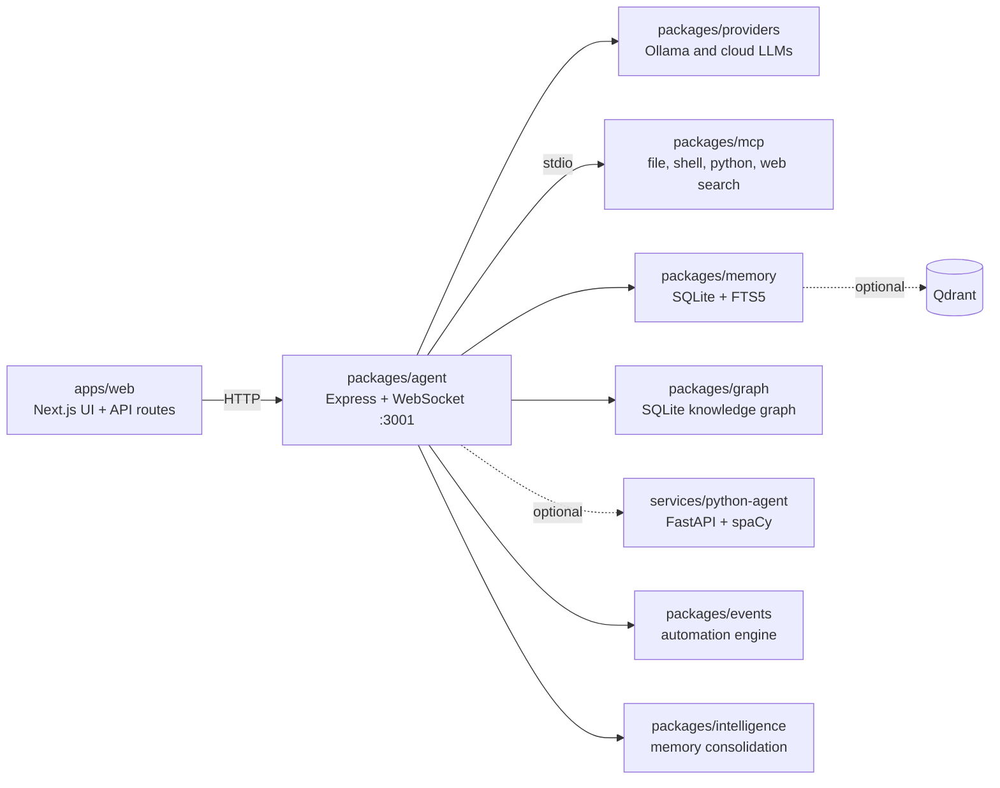

<div align="center">


# Torvaix

**A private AI workspace that runs on your own computer.**<br/>
It remembers what you tell it, links those facts into a knowledge graph, and can use tools on your behalf, with you in control of what runs.

[](https://github.com/Yashasm18/Torvaix/actions/workflows/ci.yml)
[](https://github.com/Yashasm18/Torvaix/actions/workflows/codeql.yml)
[](LICENSE)


[Quick start](#quick-start) · [Using Torvaix](#using-torvaix) · [Installation](#installation) · [Configuration](#configuration) · [Troubleshooting](#troubleshooting) · [Architecture](#architecture)

</div>

---

## What is Torvaix?

Torvaix is a chat assistant you host yourself. It is built for local models through [Ollama](https://ollama.com), so by default your conversations stay on your machine. Cloud models from OpenAI, Anthropic, Google, Groq and OpenRouter are optional: add an API key and pick one.

Unlike a plain chat window, Torvaix keeps a long-term memory for each workspace, can read and write files in a workspace folder, search the web and run commands, and lets you build your own agents and scheduled automations on top of that.

> **Status: early (v0.3), under active development.** Expect breaking changes. Torvaix is designed for one person on their own computer, not as a shared or internet-facing service. Read [SECURITY.md](SECURITY.md) before running it anywhere else.

## Quick start

You need [Node.js](https://nodejs.org) 22 or newer, Git, and either [Ollama](https://ollama.com/download) or an API key for a cloud provider.

**1. Install** (macOS and Linux; for Windows see [Installation](#installation))

```bash
curl -fsSL https://raw.githubusercontent.com/Yashasm18/Torvaix/main/install.sh | sh
```

**2. Get a model** (skip this if you will use a cloud API key)

```bash
ollama pull llama3.2
```

**3. Start it**

```bash
cd Torvaix && npm run dev
```

Open <http://localhost:3000> and say hello. To stop Torvaix, press `Ctrl+C` in that terminal.

The four dots at the bottom of the sidebar show what is running. **Agent**, **Model** and **Database** should be green. **Vectors** is optional and can stay grey.

## Features

| | |
| --- | --- |
| **Chat with memory** | Facts you share are saved per workspace and recalled in later conversations. Search combines keywords (SQLite FTS5) with vector search when Qdrant is running. |
| **Knowledge graph** | People, projects and technologies mentioned in your memories are linked and shown in an interactive graph. |
| **Tools you control** | The assistant can read and write files in the workspace folder, search the web, scan a repository, and run shell or Python commands. You choose when commands need your approval. |
| **Live view of its work** | While a reply is being worked out you see each step as it happens, and local-model replies appear as they are written. |
| **Your own agents** | Give an agent its own instructions and a fixed set of tools, for example a researcher that can only search the web. Use it in chat, run it on a task, or have an automation run as it. |
| **Automations** | Run work on a schedule, when something happens (such as a memory being saved), or by hand. |
| **Memory themes** | Finds duplicate and related memories and groups them into themes. |
| **Any model** | Ollama by default; OpenAI, Anthropic, Google, Groq and OpenRouter with an API key. Choose the model in **Settings → Models & keys**. |

## Using Torvaix

### Your first chat

Try these, in order:

1. `Remember that my favourite framework is Next.js` saves a memory.
2. `What is my favourite framework?` answers from that memory.
3. `Write a function that reverses a string` answers with code.
4. `List the files in this workspace folder` uses a tool.

Click **How I answered** under a reply to see which memories it used and the steps it took.

### Command approval

Shell and Python commands run on your computer with your permissions, so Torvaix can ask before it runs one. Choose how under the message box:

| Mode | What happens |
| --- | --- |
| **Ask every time** (default) | Every command waits until you approve that exact command. |
| **Auto** | Simple read-only commands (such as `ls` or `cat notes.txt`) and one-line arithmetic run without asking. Anything else still waits. |
| **Bypass** | Every command runs without asking. Use it only for work you trust. |

The choice applies to chat. Agent runs from the **Agents** page and automations always ask, and commands waiting for approval are listed on the **Tasks** page. Reading and writing files inside the workspace folder, and web search, never ask.

### Pages

| Page | What it is for |
| --- | --- |
| **Chat** | Talk to Torvaix, or to one of your agents. |
| **Overview** | A summary of the workspace and its recent activity. |
| **Projects** | Group your work in a workspace into projects. |
| **Knowledge** | Browse, search, add and delete memories; find themes. |
| **Knowledge graph** | See how the things you have mentioned connect. |
| **Agents** | Create agents and run them on tasks. |
| **Tasks** | The assistant's recent tool runs, and commands waiting for approval. |
| **Automations** | Scheduled and event-driven work. |
| **Models** | Which Ollama models are installed and in use. |

### Where your data lives

| What | Where |
| --- | --- |
| Memories, automations, agents, tool history | `~/.torvaix/data` (SQLite) |
| Files the assistant reads and writes | `~/.torvaix/workspaces/<workspace>` |
| Saved API keys and the chosen model | `~/.torvaix/data/settings.json`, readable only by you |
| Chats, projects and the list of workspaces | Your browser's storage. Export a copy from **Settings → General**. |

Set `TORVAIX_HOME` to keep all of the `~/.torvaix` data somewhere else.

## Installation

### Requirements

- Node.js 22 or newer, with npm
- Git
- [Ollama](https://ollama.com) running locally, **or** an API key for a cloud provider
- Optional: Docker, for Qdrant (vector search) and the Python NLP service

A small local model such as `llama3.2` (2 GB) runs on a laptop with 8 GB of memory. Larger models and cloud models give noticeably better answers, especially for multi-step tool use.

### Manual install

The [installer](install.sh) in the quick start does exactly this. It does not use `sudo`, and running it again updates your copy.

```bash
git clone https://github.com/Yashasm18/Torvaix.git
cd Torvaix
npm install
cp .env.example .env
```

**Windows:** run the same commands in PowerShell, with `copy` in place of `cp`. Torvaix has not been tested on Windows yet; if it does not start, use WSL and follow the macOS and Linux steps.

### Models

```bash
ollama pull llama3.2
```

```bash
ollama pull nomic-embed-text
```

`llama3.2` is the chat model and `nomic-embed-text` powers vector search. Any installed chat model works: unless you choose one, Torvaix uses whichever suitable model is installed (for example `llama3.2:3b`). The **Models** page shows what is installed and what is missing.

To use a cloud model instead, open **Settings → Models & keys**, paste a key, and choose a model.

### Optional: vector search with Qdrant

Without Qdrant, memory search uses keywords only, which works but is less accurate. You can start Qdrant at any time; Torvaix notices within 30 seconds and indexes the memories you already have.

```bash
docker compose up -d qdrant
```

### Running

```bash
npm run dev
```

This starts the agent server on `127.0.0.1:3001` and the web app on `127.0.0.1:3000`. Both are reachable only from this computer. `npm run dev:open` does the same and opens the browser for you.

For a production build:

```bash
npm run build
npm start
```

### Docker

```bash
docker compose up -d
```

This builds and starts the whole stack: Qdrant, Ollama (which pulls `llama3.2` and `nomic-embed-text` on first start), the Python NLP service and the app. The first build and model download take a while. The web app is published on `127.0.0.1:3000`, and your data is kept in the `torvaix_data` volume.

### Updating

```bash
cd Torvaix && git pull && npm install
```

Then restart Torvaix. Your data in `~/.torvaix` is kept.

## Configuration

The chat model and API keys can be set in the app, under **Settings → Models & keys**. A model chosen there wins over `TORVAIX_MODEL`, and a key saved there wins over the one in `.env`. They are stored in `settings.json` in the data folder, readable only by your user, and keys are never sent back to the browser.

Everything else is set in `.env`. Copy `.env.example` to `.env` in the repository root. Every setting is optional, and variables already set in your shell take precedence.

| Variable | Default | Purpose |
| --- | --- | --- |
| `TORVAIX_HOME` | `~/.torvaix` | Where databases (`data/`) and workspace folders (`workspaces/`) are stored |
| `TORVAIX_MODEL` | an installed Ollama model | Chat model ID, local or cloud, unless one is chosen in Settings |
| `OLLAMA_URL` | `http://localhost:11434` | Ollama endpoint |
| `QDRANT_URL` | `http://localhost:6333` | Qdrant endpoint |
| `PYTHON_SERVICE_URL` | `http://localhost:8000` | Optional NLP service for entity extraction |
| `WEB_HOST` | `127.0.0.1` | Interface the web app listens on. Keep it on loopback. |
| `WEB_ALLOWED_HOSTS` | localhost only | Extra host names the web app answers to, e.g. a LAN address you open it with |
| `AGENT_PORT` / `AGENT_HOST` | `3001` / `127.0.0.1` | Agent server address. Keep it on loopback. |
| `AGENT_SERVER_URL` | `http://localhost:<AGENT_PORT>` | Where the web app sends requests for the agent. Only needed when the agent runs on another machine or host name. |
| `AGENT_ALLOWED_ORIGINS` / `AGENT_ALLOWED_HOSTS` | localhost only | Extra origins or hosts the agent accepts |
| `OPENAI_API_KEY`, `ANTHROPIC_API_KEY`, `GOOGLE_API_KEY`, `GROQ_API_KEY`, `OPENROUTER_API_KEY` | none | Enable cloud providers (or add the key in Settings) |
| `JWT_SECRET` | random at startup | Signs login tokens |
| `OPENROUTER_REFERER` | `https://torvaix.local` | The `HTTP-Referer` sent with OpenRouter requests |
| `TORVAIX_SHOW_LANDING` | unset | Set to `1` to see the landing page at `/`. Otherwise `/` opens the chat. Useful when working on that page. |

If `OPENAI_API_KEY` is set in `.env` and Ollama can't produce embeddings, memory text is sent to OpenAI for embeddings. If neither is available, Torvaix uses a local keyword-based embedding.

## Troubleshooting

| Problem | What to do |
| --- | --- |
| **The Model dot is red**, or chat says "Ollama isn't running" | Start Ollama by opening the app, or run `ollama serve`. |
| **`ollama serve` says "address already in use"** | Ollama is already running. Nothing to do. |
| **"The model … isn't installed in Ollama"** | Run `ollama pull llama3.2`, or choose an installed model in **Settings → Models & keys**. |
| **"Port 3000 (or 3001) is already in use"** | Another copy of Torvaix, or another program, is using it. Stop that one, or set `PORT` / `AGENT_PORT` in `.env`. If your `.env` also sets `AGENT_SERVER_URL`, change its port to match `AGENT_PORT` or remove that line. |
| **The Agent dot is red** | The agent server is not running. Start both parts together with `npm run dev`. |
| **Replies are slow** | A local model's speed depends on your hardware. Try a smaller model, close other heavy apps, or use a cloud model. |
| **The assistant runs odd commands or loops** | Small local models are weak at multi-step tool use. Keep **Ask every time** on and deny what you do not expect, or switch to a larger or cloud model. |
| **Memory search misses things** | Start Qdrant and pull `nomic-embed-text` for vector search. |
| **An error mentioning `better-sqlite3` after changing Node versions** | Run `npm rebuild better-sqlite3`. |

Still stuck? [Open an issue](https://github.com/Yashasm18/Torvaix/issues) with what you ran and what you saw.

## Architecture



Each request goes through a fixed sequence of steps rather than an open-ended agent loop. A router classifies the message, first by keyword rules and then with the model if needed, and sends it to one handler:

| Route | What it does |
| --- | --- |
| `memory` | Recalls stored facts and answers from them |
| `knowledge` | Stores a new fact and updates the graph |
| `conversation` | Answers normally, with relevant memory and graph context |
| `execution` | Calls tools. `bash` and `python` wait for approval, depending on the [approval mode](#command-approval). |
| `repo_analysis` | Scans the workspace folder and summarises it |

| Path | Contents |
| --- | --- |
| `apps/web` | Next.js 16 app (React 19, Tailwind 4) |
| `packages/agent` | Agent server, orchestrator, request validation, HTTP security |
| `packages/memory` | Memory store, workspaces, automations, pending approvals |
| `packages/graph` | Knowledge graph storage and queries |
| `packages/mcp` | MCP tool server and client |
| `packages/providers` | LLM provider client |
| `packages/events` | Automation scheduler and event bus |
| `packages/intelligence` | Memory consolidation and synthesis |
| `services/python-agent` | Optional NLP service (entity and relation extraction) |

### Companion devices (experimental)

The agent has endpoints for pairing another device with a one-time token. This is an early prototype: pairing and sessions work, but the `readonly` and `admin` scopes are **not yet enforced** on other endpoints. See [docs/architecture/companion.md](docs/architecture/companion.md).

## Development

```bash
npm run test:ci      # run the test suite once (Vitest)
npm run typecheck    # type-check the packages
npm run lint         # lint the web app
npm run build        # production build
npm run benchmark    # write BENCHMARKS.md and a snapshot under benchmarks/history/
```

Bug reports and pull requests are welcome. See [CONTRIBUTING.md](CONTRIBUTING.md) for the workflow and [CHANGELOG.md](CHANGELOG.md) for what changed in each release.

## Agent API

The web app talks to the agent server, which you can also call directly from the same machine:

```bash
curl http://localhost:3001/api/health
```

```bash
curl -X POST http://localhost:3001/api/memory/store \
  -H "Content-Type: application/json" \
  -d '{"workspaceId":"default","content":"My favourite language is Python"}'
```

```bash
curl -X POST http://localhost:3001/api/memory/query \
  -H "Content-Type: application/json" \
  -d '{"workspaceId":"default","query":"Which language do I prefer?","topK":3}'
```

Other endpoints: `POST /api/agent/run`, `POST /api/agent/approve`, `GET /api/agent/pending-actions`, `GET /api/agent/executions`, `GET /api/memory/insights`, `POST /api/memory/consolidate`, and `/api/automations`. The web app exposes the knowledge graph at `GET /api/graph` (`?stats=true`, `?center=<entity>&depth=2`, `?q=<text>&type=<TYPE>`).

## Security

Torvaix can run commands on your computer, so a few things are worth knowing:

- It listens only on `127.0.0.1` by default. Keep it that way unless it sits behind a firewall or an authenticating proxy: the web app has no login.
- Approved commands are **not sandboxed**. They start in the workspace folder but run with your user permissions.
- Web pages, files and memories go into the model's context and can try to steer it. **Ask every time** is the safest mode, and **Bypass** removes that protection.

The full picture, including how to report a vulnerability, is in [SECURITY.md](SECURITY.md).

## License

[GNU AGPL v3.0](LICENSE). If you run a modified version of Torvaix as a network service, you must offer its source code to that service's users.
