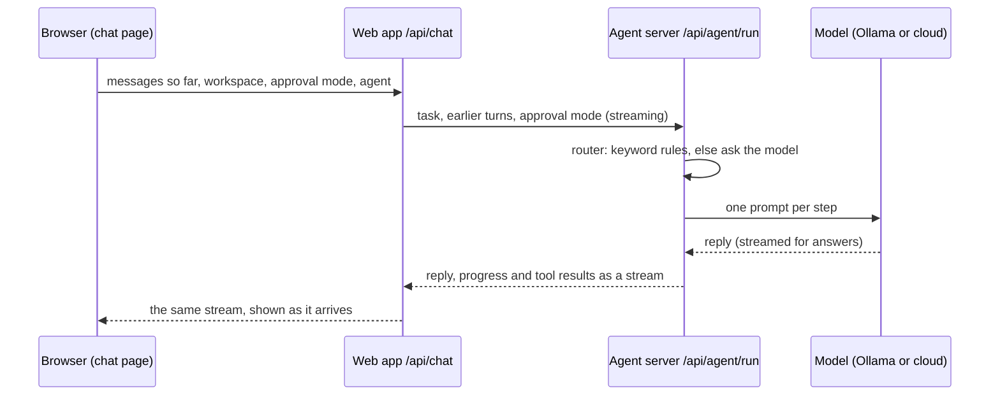

# How a chat message works

This page follows one message from the chat box to the model and back. It also covers what the model sees, how much of the conversation it gets, and what to change when a local model struggles.

## The path of a message

1. **The browser keeps the chat.** Each chat's messages live in the browser's IndexedDB, up to the last 200 per chat (`apps/web/src/store/chat-history.ts`). The server keeps memories, files, agents, automations and approvals. It doesn't keep the chat.
2. **The web app passes it on.** `apps/web/src/app/api/chat/route.ts` turns the chat into a request for the agent server (`apps/web/src/lib/chat-request.ts`). The last message is the task. Earlier messages are the history, at most 100 entries, and each command's output is cut to 6,000 characters. When the message is an approval, the task stays the user's original request.
3. **The agent server picks a route.** `packages/agent/src/orchestrator.ts` runs fixed steps, at most 10 per message. Clear requests are routed by keyword rules (`routing.ts`). For anything else the model is asked for one word (memory, knowledge, execution or conversation). A reply that names no category, or several, is treated as a conversation.
4. **The route does the work:**
   - **conversation:** answers with the history, up to 3 matching memories, and up to 8 knowledge-graph relations. The answer streams as it is written.
   - **memory:** finds up to 5 memories, or the 5 most recent, and answers from them with the history. Each memory carries the day it was saved, and the model is told to prefer the newer one when two disagree. The answer streams as it is written.
   - **knowledge:** saves the message as a memory and adds what it mentions to the graph.
   - **execution:** asks the model for one JSON step at a time, either a tool call or "done". Each tool result goes back into the next step's prompt. `bash` and `python` wait for approval unless the approval mode allows them.
5. **The stream comes back.** The browser shows the reply, the progress lines ("Planning the next step"), the tool cards and approval requests, and "How I answered".

## What the model sees, and how much of it

| Part | Limit |
| --- | --- |
| History in a prompt | The most recent turns that fit in 12,000 characters (about 3,000 tokens). Tool results count too. |
| One tool result | 6,000 characters. It keeps the start and the end, where errors and totals usually are. |
| Memories | 3 in a conversation, 5 for a recall, 500 characters each for an agent |
| Reply length | Up to 4,096 tokens |

Conversation and recall prompts also carry today's date (from the agent server's clock), so questions about "today" or "how long ago" aren't answered from the model's training data.

A tool step's prompt includes the rules and tool list, the task, the history and any memories. It comes to about 3,500 tokens. A conversation prompt with a full history is about 3,000 tokens.

## Ollama's context window

Ollama gives a model a small context window unless it is asked for more. A few thousand tokens is common, and the exact default depends on your Ollama version and hardware. When a prompt doesn't fit, Ollama drops part of it without saying so. The model then forgets the task, the tools, or that it must reply in JSON.

Torvaix therefore asks Ollama for an 8,192-token window with every request. It sends the same size each time, because a different size makes Ollama reload the model. You can change it with `TORVAIX_NUM_CTX`:

- Use a bigger value, such as `16384`, if you have the memory and use long chats or large files.
- Use a smaller value, such as `4096`, on a machine that runs out of memory.
- Use `0` to keep whatever your Ollama is set to, for example `OLLAMA_CONTEXT_LENGTH`.

A bigger window uses more memory.

## How Torvaix copes with local models

| What local models do | What Torvaix does |
| --- | --- |
| Wrap the one-word category in a sentence ("Category: **execution**.") | Reads the category from anywhere in the reply |
| Write a tool step as prose with JSON in it, or JSON that doesn't parse | Asks Ollama for JSON output (`format: "json"`), takes the first complete JSON object, and asks again once when it doesn't parse |
| Reason first in `<think>…</think>` (DeepSeek-R1, Qwen3 and others, depending on the Ollama version) | Leaves the reasoning out of the reply, the category and the tool step |
| Take minutes to load or to read a long prompt on a CPU | Waits up to 5 minutes for Ollama (2 for cloud models). `TORVAIX_MODEL_TIMEOUT` sets it in seconds. |
| Repeat the same tool call | Stops and answers from the result it already has |
| Ask for a tool the agent wasn't given | Never runs it, tells the model once, then stops |

Small models are still weaker at tasks with several steps than larger or cloud models. Keep **Ask every time** on so you see each command before it runs.

## Where to look when something is wrong

- **"How I answered"** under a reply shows the route, the model, the memories used and each step.
- **The agent server's log** prints each step (`[Router Agent] Decision: …`, `[STEP START] Iteration …`).
- **Settings → Models & keys → Test** checks that the model answers.
- **`npm run test:e2e`** drives the whole app in a browser against a stand-in model (`e2e/fake-model.mjs`). The stand-in replies the way local models do: wordy categories, thinking tags and replies streamed in pieces. It also records what Torvaix sent, so the tests check the context window and JSON mode.
